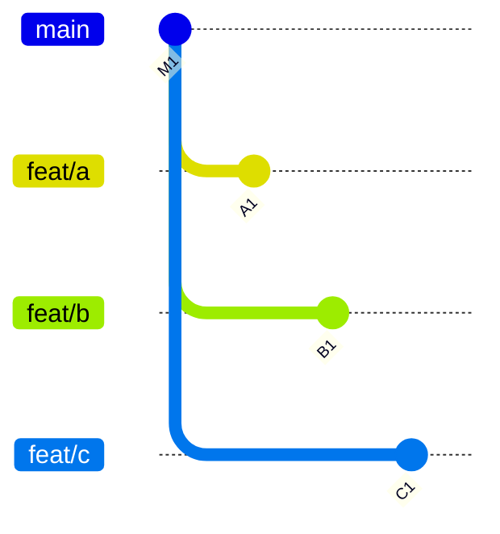
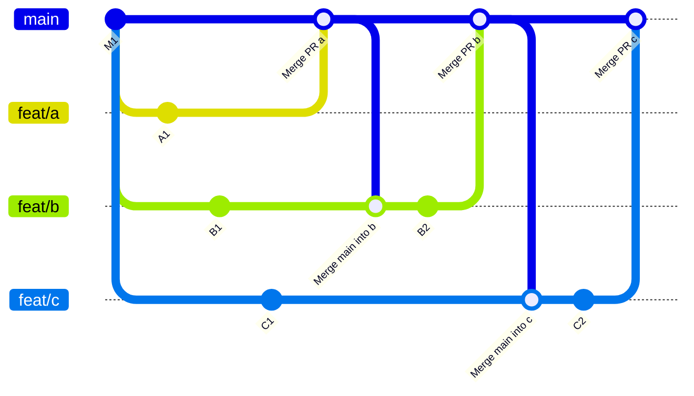
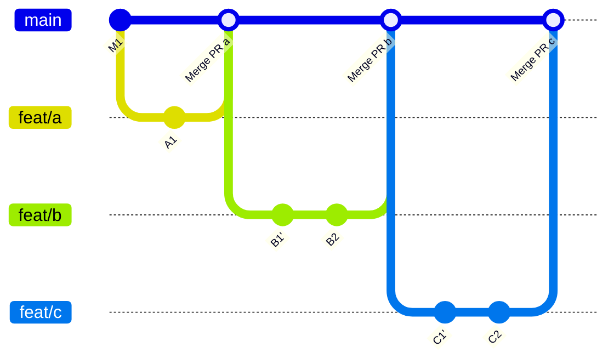
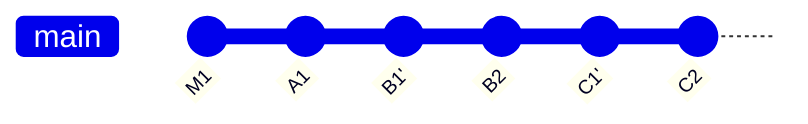

When you branch from `main`, other branches will often be merged into `main` while yours is still in progress. Before your branch can merge, you need those new changes in it. There are two ways to do this:

- Merge `main` into your branch. This keeps history as it happened but adds a merge commit each time.
- Rebase your branch onto `main`. This replays your commits on top of the latest `main`, giving a linear history with no extra merge commits.

Rebasing usually produces a cleaner history, but it rewrites commit hashes, so it's best for branches only you are working on, and it needs a force-push (`--force-with-lease`). This page walks through both approaches with examples and diagrams of what each does to Git's history.

## The scenario

Three branches start from the same commit on `main` (M1):

- `feat/a` adds A1 and is merged first.
- `feat/b` adds B1. After `feat/a` lands, it is updated, gets more work (B2), and is merged second.
- `feat/c` adds C1. After both land, it is updated, gets more work (C2), and is merged last.

```shell
git switch main
git switch -c feat/a && echo a > a.txt && git add . && git commit -m "feat: add a"
git switch main
git switch -c feat/b && echo b > b.txt && git add . && git commit -m "feat: add b"
git switch main
git switch -c feat/c && echo c > c.txt && git add . && git commit -m "feat: add c"
```

Starting state with all 3 branches off M1:



## Step 1: Merge feat/a into main

```shell
git switch main
git merge --no-ff feat/a  # or merge PR on Github/Gitlab/etc
```

Now `main` has moved ahead, so `feat/b` and `feat/c` are both behind.

### Option 1: Merge main into your branch

```shell
git switch feat/b
git merge main              # creates a merge commit
# ...work: commit B2...
git switch main
git merge --no-ff feat/b

git switch feat/c
git merge main              # another merge commit (now includes B)
# ...work: commit C2...
git switch main
git merge --no-ff feat/c
```

Each update leaves a "Merge branch 'main' into feat/x" commit (MB, MC) in the history. For example Merge branch 'main' into `feat/some-new-feature`.



### Option 2: Rebase branch onto main

```shell
git switch feat/b
git rebase main             # B1 is replayed on top of main as B1'
# ...work: commit B2...
git push --force-with-lease # only needed if already pushed
git switch main
git merge --no-ff feat/b    # or fast-forward / squash

git switch feat/c
git rebase main             # C1 replayed as C1' on top of main (A + B)
# ...work: commit C2...
git push --force-with-lease
git switch main
git merge --no-ff feat/c
```

The commits get new hashes (B1', C1'), but the history has no "merge main into…" commits. Only the PR merge commits remain. If you want a fully linear `main`, use `git merge --ff-only feat/b` or your Git forge's rebase-merge. Fast-forward only works when the branch has already been rebased onto the latest `main`.



## Fully Linear Variant

If you don't want PR merge commits either, rebase and then fast-forward:



## Comparison

|                   | Merge main into branch             | Rebase onto main                    |
| ----------------- | ---------------------------------- | ----------------------------------- |
| Extra commits     | One merge commit per update        | None                                |
| Commit hashes     | Preserved                          | Rewritten for your branch's commits |
| Push after update | Plain `git push`                   | `git push --force-with-lease`       |
| Conflicts         | Resolved once, in the merge commit | May be resolved per replayed commit |
| Best for          | Shared branches                    | Your own branches                   |
| History           | Branchy, true to what happened     | Linear, easier to read              |
